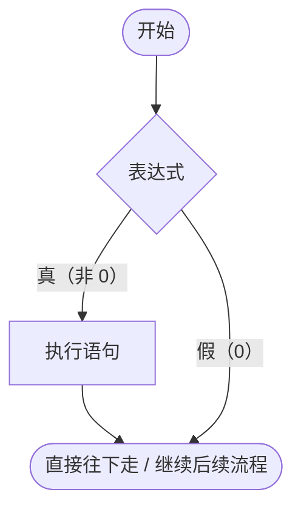
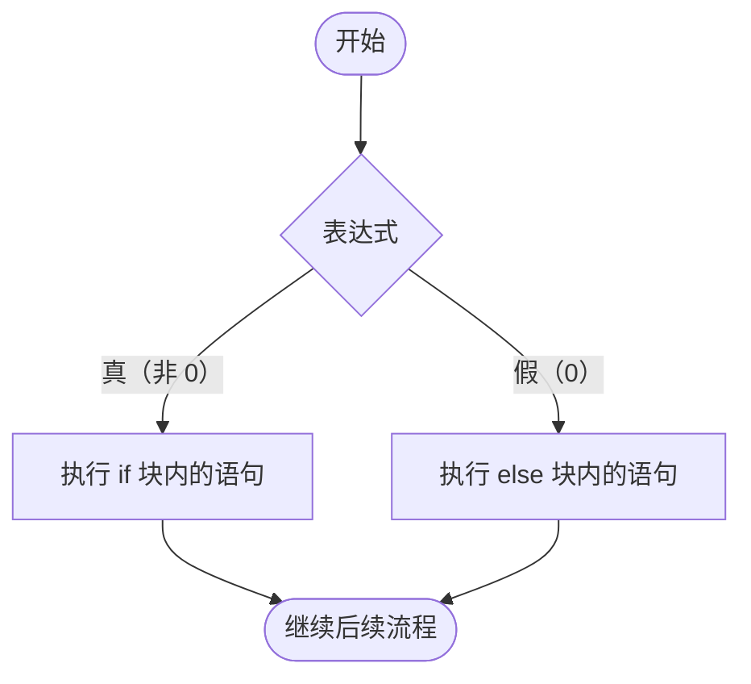
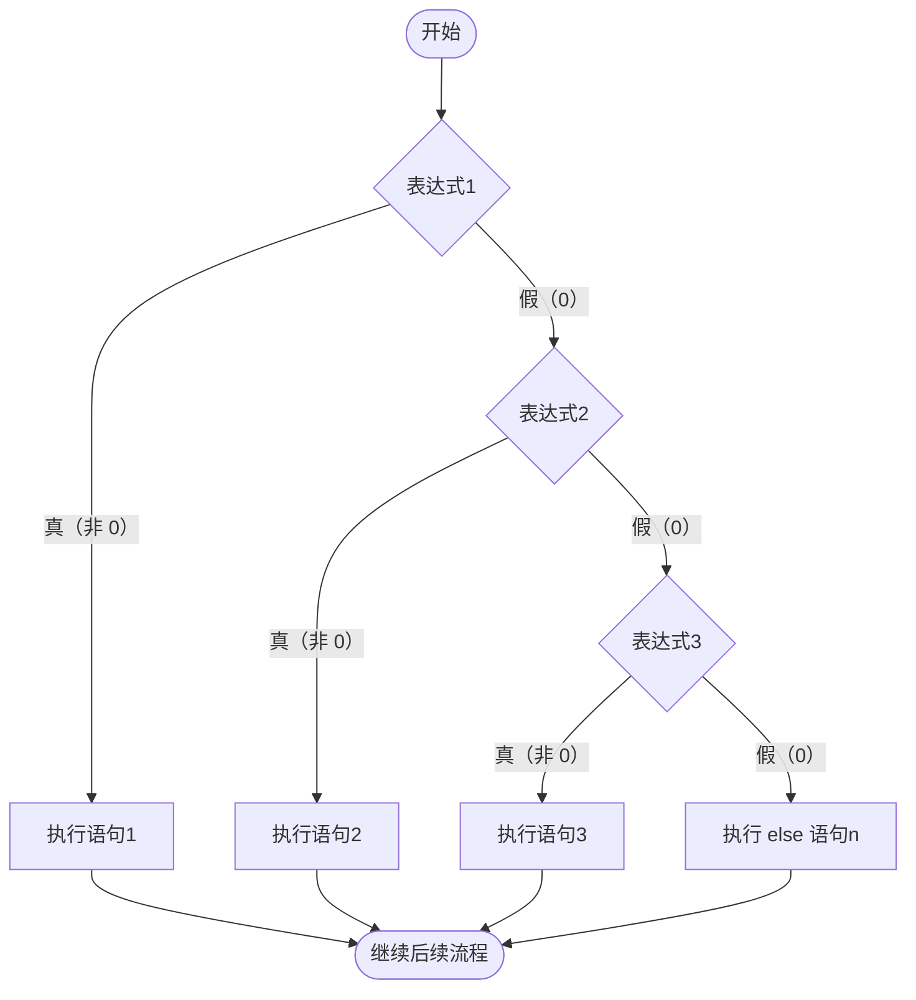

## 分支结构

程序结构：
1. 顺序结构
1. 分支结构
1. 循环结构

补充 - 算法思想：
1. 递归
1. 分治
1. 回溯 - ...


### if 语句

If 语句的三种基本形式

1. 条件结构
```c
if (表达式)
   语句;
```
例子
```c
if (x < y)
    printf("%d", x);
```

if 后面跟的多于一个语句，必须跟大括号
```c
if (条件) {
    语句1;
    语句2;
    ...
}
```



2. 分支选择
```c
if (表达式) {
    语句若干 ...;
} else {
    语句若干 ...;
}
```



3. 多分支选择

```c
if (表达式1) {
    语句1;
} else if (表达式2) {
    语句2;
} else if (表达式3) {
    语句3;
} else {
    语句n; // 以上条件都不满足时执行
}
```




### 如何使用 if 条件结构

运算符

| 运算符 | 名称 | 含义 | 示例 | 记忆口诀 |
| :---: | :--- | :--- | :--- | :--- |
| `&&` | **逻辑与** (AND) | 两边条件**同时为真**（非0）时，结果才为真 | `if (a > 0 && b > 0)` | **一假则假，全真才真** |
| `\|\|` | **逻辑或** (OR) | 两边条件**只要有一个为真**（非0），结果就为真 | `if (a > 0 \|\| b > 0)` | **一真则真，全假才假** |
| `!` | **逻辑非** (NOT) | **单目运算符**，对条件进行取反（真变假，假变真） | `if (!a)` | **非真即假，非假即真** |

**💡 C语言补充说明：**
* **真假判定**：C语言中，**非 0 即为真**，**0 即为假**。逻辑运算的结果只有两种：`1`（代表真）和 `0`（代表假）。
* **优先级**：`!`（逻辑非） > 算术运算符 > 关系运算符 > `&&`（逻辑与） > `||`（逻辑或） > 赋值运算符。所以 `&&` 会比 `||` 优先计算。
* **短路特性（重点）**：
  * 对于 `A && B`：如果 A 为假（0），则不再执行 B。
  * 对于 `A || B`：如果 A 为真（非0），则不再执行 B。

例 2：令狐冲 c 语言成绩大于 90 分，而且音乐成绩大于 80 分，师傅奖励他；或者 c 语言成绩等于 100 分，音乐成绩大于 70 分，师傅也可以奖励他

```c
int grade_c = input(int), grade_music = input(int);
if (grade_c > 90 && grade_music > 80
  || grade_c == 100 && grade_music > 70) {
    award();
}
```
*(注：因为 `&&` 优先级高于 `||`，上面代码等价于 `(grade_c > 90 && grade_music > 80) || (grade_c == 100 && grade_music > 70)`)*