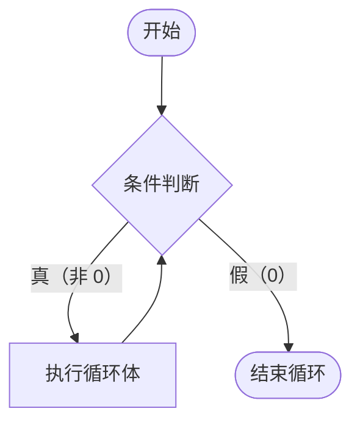
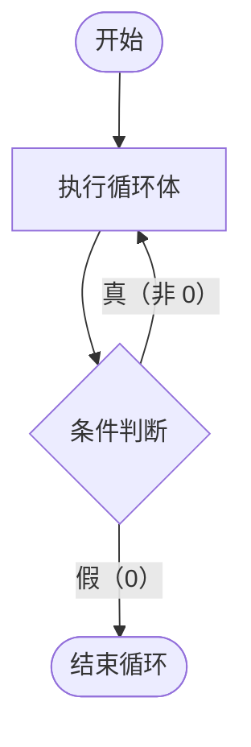
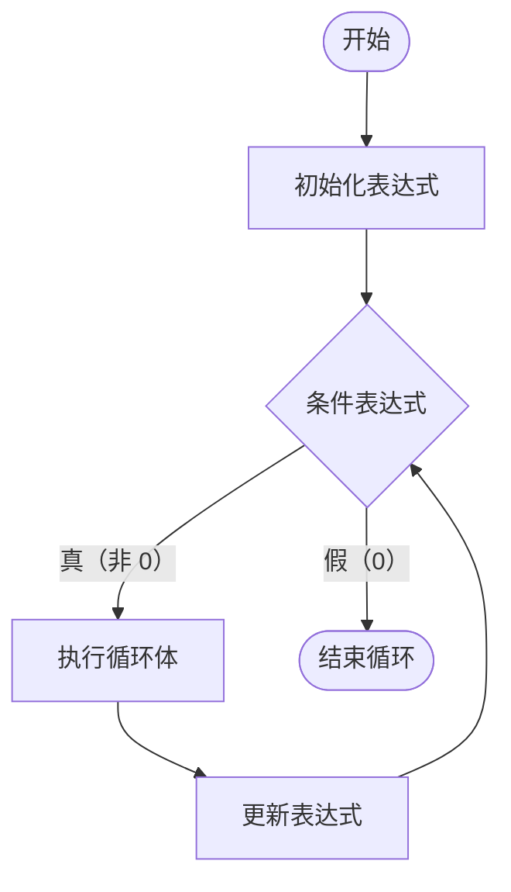

### 分支 嵌套

语法：

```c
if (条件1) {

    if (条件2) {
        语句;
    } else {
        语句;
    }

    语句;

} else {

    if (条件3) {
        语句;
    } else {
        语句;
    }
    
    语句;
}
```

诺注：写出多层嵌套时，应当优先思考是否能简化为**扁平的** `if - else if` 结构
如果单个条件过长，应当优先思考是否能拆成嵌套的 if 结构
代码在效率、结果正确之后，应当优先服务于可读性


### if - else 配对

else 总是与离他最近的 未配对的 if 进行配对

```c
int a, b, c;

if (a > b)
    if (a > c)
        printf("%d 最大", a);
else
    语句;
```

此时 else 跟 if (a > c) 配对，而非 if (a > b)，跟缩进无关
诺注：代码中应避免这种情况出现，对可读性的打击很大


### 思考题

自学：条件运算符（三目）

#### 1. 基础用法

三目运算符是 C 语言中唯一的一个三目运算符，它其实就是 `if-else` 的**简写形式**，专门用于处理**简单的二选一赋值或输出**。

语法格式：
```c
条件表达式 ? 表达式1 : 表达式2
```

**执行逻辑**：
*   如果“条件表达式”为**真（非 0）**，整个运算的结果就是 `表达式1` 的值；
*   如果“条件表达式”为**假（0）**，整个运算的结果就是 `表达式2` 的值。

**基础示例**：
```c
int a = 10, b = 20;

// 找出 a 和 b 中的较大值
int max = (a > b) ? a : b; 
// 因为 a > b 是假，所以把 b 的值（20）赋给 max

// 判断奇偶并输出
(a % 2 == 0) ? printf("偶数\n") : printf("奇数\n");
```

#### 2. 为什么条件部分一定要加括号？

很多同学在写三目运算符时，习惯写成 `a > b ? a : b`，这本身没有语法错误，但**强烈建议条件部分加上括号** `(a > b) ? a : b`。原因有两点：

1. **优先级导致的逻辑陷阱**：
   虽然 `>`、`<` 的优先级高于 `? :`，但在遇到赋值语句或复合条件时，不加括号极易出错。
   *   **错误写法**：`int max = a > b ? a : b;`（可读性差，且一旦混入赋值运算符容易翻车）。
   *   **若遇到复杂条件**：比如 `(a > 0 && b > 0) ? x : y`，如果不加括号写成 `a > 0 && b > 0 ? x : y`，因为 `&&` 优先级高于 `?:`，虽然能跑通，但阅读时非常容易看花眼。
2. **可读性（最重要）**：
   加括号可以清晰地圈出“条件”和“结果”的边界。就像在数学里写 `(a+b) * c` 一样，让人一眼看出这是一个整体的判断条件，而不是一堆杂乱的符号堆砌。代码是写给人看的，清晰的边界感能避免后期调试抓狂。

#### 3. 使用建议（诺注）

*   **能用就顺手用**：对于**只需要执行一个简单的赋值、或者一句话的输出**，三目运算符比 `if-else` 更简洁，能省去大括号，代码看着紧凑。
*   **复杂了别硬用**：如果条件非常长，或者成立/不成立的后果是多条语句，**千万要退回用 `if-else`**。三目嵌套（如 `a ? b : c ? d : e`）是 C 语言新手灾难，可读性极差，绝对不要用。


### 项目简介

- 项目名称：万年历
- 项目简介：输入 年、月，打印月历

```
请输入年份：2008

请输入月份：10
这个月的日历为
***************2008年10月************
  sun  Mon  Tue  Wed  Thu  Fri  Sat
后续省略
```

#### 阶段任务 2 - 打印傻日历

```
请输入年份：2026
请输入月分：6
日  一  二  三  四  五  六
1   2   3   4   5   6   7
后续省略
```
这里月分应该是原截图笔误


### 循环结构

4.1 统计成绩（while）
4.2 统计一个整数的位数（do-while）
4.3 判断素数（break 和 continue）
4.4 循环结构程序设计

- 什么是循环？为什么要使用循环？如何实现循环？
- 实现循环时，如何确定循环条件和循环体？
- 怎样使用 while 和 do-while 语句实现次数不确定的循环？
- while 和 do-while 语句有什么不同？

诺注：开发场景下，do while 的使用频率很低，大部分时候可以被 while 和 for 代替，do while 是无论如何至少循环一次，然后再判断是否要退出，属于早期可读性比较低的逻辑，即便真要使用，现在也是用 for 去写这个逻辑


#### 4.1 while

当型循环：先判断，后执行，最低循环次数是 0

语法
```c
while (条件)
    循环体语句;
```

**流程图：**


```c
int sum = 0,
    i = 1;      // 初始化
while (i <= 0) {// 循环条件
    sum += i;
    i ++;       // 迭代
}
```
求 1 到 10 的和

#### 4.2 do-while

语法（注意：末尾必须有分号）
```c
do {
    循环体语句;
} while (条件);
```

**流程图：**


#### 4.3 for

语法
```c
for (初始化表达式; 条件表达式; 更新表达式) {
    循环体语句;
}
```

**流程图：**


---

### 💡 补充解析：为什么 `do-while` 用得少？

你的直觉非常对，在现代工程开发中，`do-while` 确实是“最不受待见”的循环。原因有以下三点：

1. **可读性反直觉**：
   人类阅读代码习惯“自上而下”。`while` 和 `for` 都是“先看条件，再执行”；而 `do-while` 是“先斩后奏”，不管三七二十一先跑一次循环体，再去底部看条件。如果循环体很长，读代码的人看到底部才知道退出的条件是什么，思维负担很重。
2. **几乎都能被替代**：
   * `do-while` 的场景可以用 `while` 替代：先在外面执行一次，再用 `while` 判断。
   * 或者更常见的是用 `while (1) { ... if (条件) break; }` 来替代。
3. **真正的用途极其有限**：
   它其实只在一种极端场景下无可替代：**无论如何必须执行一次，且第一次执行不需要条件（或者第一次执行前变量还没初始化）**。
   * **场景一：宏定义（底层开发必备）**。C 语言里用 `#define` 定义多行语句时，必须用 `do { ... } while(0)` 包裹，这是为了吃掉末尾的分号，防止语法错误。
   * **场景二：菜单交互**。先显示一次菜单，然后再根据用户的选择（条件）决定是否继续循环。但在现代高级语言（如 Python）中，这个逻辑通常用 `while True:` 加 `break` 来写了。

**总结**：就像你笔记里写的，现代开发中即便碰到“至少执行一次”的逻辑，大家也宁愿用 `while(1) { if(...) break; }` 或者 `for(;;)`，因为这样既满足了逻辑，又把退出条件放在了显眼的开头或中间，可读性更好。