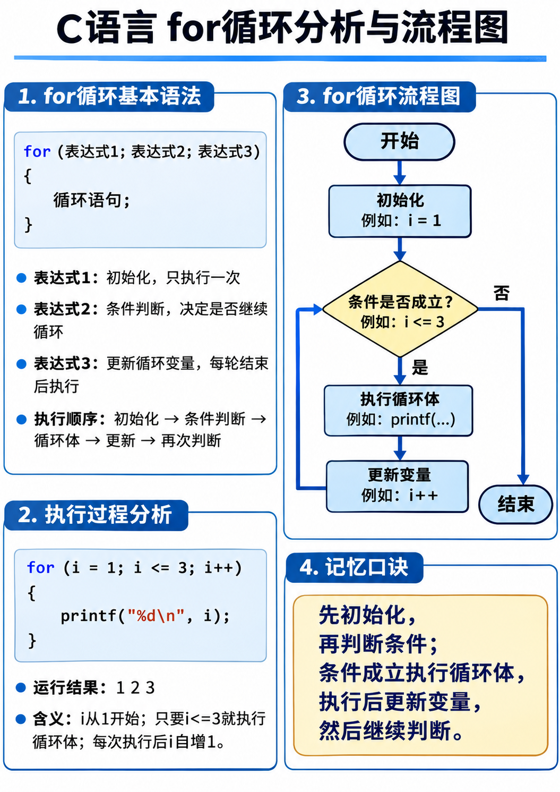

### 简单的 for 循环

语法：for 循环的语法和执行顺序

```c
for (初始化; 条件; 迭代) {
    语句;
}
```
- `初始化`（参数初始化） 在循环进入时执行一次，一般用于定义迭代变量，重置其他相关变量
- `条件`（条件判断） 和 while 一样，当条件为真时继续执行，当条件为假时就退出了 
- `迭代`（更新循环变量） 一般用于对迭代变量进行增减等操作，对循环主体的变量的操作原则上不应放到这里，应该放进循环体；如果迭代变量的迭代过于复杂， 也可以考虑放到循环体做处理

**流程图：**




形如

```c
int array[n];
for (int i = 0, temp; i < n; i++) {
    scanf("%d", &temp);
    array[i] = temp;
}
```

如无必要，请不要写形如下面代码的循环，尽可能将迭代变量的作用域控制在循环内，让他自行释放

```c
int i;
for (i = 0; i < n; i++) {

}
```
如果在外面定义了迭代变量，而且里面沿用了，那么在下面这个循环结束的时候，i 的值其实已经是 n 了，因为 i >= n 才会退出，所以 i 实际上已经迭代到 n 了

危险的地方在于，如果你忘记在某个循环对 i 做初始化（当然项目内可能是更复杂的结构体的初始化，很可能会忘记初始化某一部分细节），如果你每一次迭代都是在循环内定义迭代变量，那么会报错，你就能 debug

但如果你喜欢在外面定义迭代变量，很可能不会报错，而是沿用一个并没有重新初始化的迭代变量（譬如你在构建一个循环的时候被叫去干别的，或者去吃饭了，走之前来不及写 TODO 注释，回来忘记初始化，然后看到自己有个循环就去写下面的内容了）

---

### 逗号表达式

形如
```c
i = 1, sum = 0;
```

其结果是最后一个表达式的值，此处为 0
逗号运算优先级是最低的一档

---

#### 省略初始化

**语法**：`for (; 条件; 迭代)`

**说明**：初始化的动作被放在了 `for` 循环的外部。
**使用案例**：
```c
int i = 0; // 在外部初始化
// 此时 for 内部只写条件判断和迭代
for (; i < 5; i++) {
    printf("%d ", i);
}
```
**诺注**：虽然有这种写法，但在 C 语言中，循环变量越贴近使用它的地方越好。写在外部会扩大变量的作用域（如果是在函数内定义），容易在后面引发变量名遮蔽或沿用旧值的 Bug。非必要不使用。

---

#### 省略条件

**语法**：`for (初始化; ; 迭代)`

**说明**：省略了中间的条件表达式，在 C 语言中，这等价于条件永远为真（非 0），会变成一个**死循环**。
**使用案例**：通常用于在循环体内根据某个特定条件跳出（配合 `break`），或者用于某些需要无限运行直到接收到信号退出的底层程序。
```c
int num;
for (int i = 0; ; i++) {
    scanf("%d", &num);
    if (num == 0) { // 遇到输入 0 时强行退出循环
        break;      
    }
    printf("读入了: %d\n", num);
}
```
**诺注**：如果连中间的 `; ;` 都不写，那么整个循环体里面必须有且至少有一个能够终结循环的 `break` 语句，否则程序就永远停在这里了。

---

#### 省略迭代

**语法**：`for (初始化; 条件; )`

**说明**：把更新循环变量的操作（如 `i++`）移到了循环体的内部。
**使用案例**：当循环的“步进”逻辑比较复杂，或者并不是每次都需要步进（比如在 `continue` 之前有特殊逻辑），又或者是在遍历链表等数据结构时，通常会把迭代写在内部。
```c
for (int i = 0; i < 10; ) {
    printf("%d ", i);
    
    // 如果满足某种条件，我们想让 i 跨步跳跃，而不是死板地 +1
    if (i == 4) {
        i += 3; // 相当于一次迭代跳跃了 3 格
    } else {
        i++;    // 正常的迭代逻辑
    }
}
// 输出结果: 0 1 2 3 4 7 8 9
```
**诺注**：省略迭代后，一定要警惕循环体内是否有修改循环变量的代码（例如 `i++` 或者 `i += 3`）。如果漏写了，哪怕条件再简单，也会变成死循环。

---

#### 💡 补充：全部省略 `for (;;)`

在 C 语言中，如果你全省略，写成 `for (;;)`（注意中间的 `;` 不能省），这是最经典、最纯粹的死循环写法（等价于 `while (1)`）。它通常出现在：
1. 嵌入式开发的主循环（Main Loop）
2. 游戏引擎的主循环
3. 配合 `break` 使用的菜单循环

```c
for (;;) {
    // 这里会一直循环
    // 直到遇到 break 才会退出
}
```

#### 💡 延伸场景：线程主循环与永续服务（配合 try-catch）

老师提到的“有些线程的主循环希望是永续的，就没有条件，除非 catch 到报错”，这在工程中极其常见。

以服务端开发为例，一个后台工作线程通常被设计为“死循环”。它不断地从队列里取任务、处理任务，**因为理论上它不知道什么时候会停下来**（通常由外部发送终止信号）。而为了程序的健壮性，会在循环内部包裹 `try-catch` 块。一旦发生致命错误，捕获异常后可以通过 `break` 跳出这个无条件的 `for(;;)`，或者直接 `return` 结束线程。

**使用案例（以 C++ 伪代码为例，C 语言没有原生 try-catch，通常靠返回值/错误码判断）**：
```cpp
void* worker_thread(void* arg) {
    // 永续循环，无条件
    for (;;) {
        try {
            // 1. 阻塞等待任务（比如从队列取数据）
            Task task = queue.pop(); 
            
            // 2. 检查是否收到全局退出信号
            if (global_stop_flag) {
                break; // 安全退出
            }
            
            // 3. 执行业务逻辑
            process(task);
            
        } catch (const std::exception& e) {
            // 捕获到异常，比如队列崩溃、内存溢出等
            log_error("Thread caught exception: ", e.what());
            // 根据业务需要，决定是重启循环还是直接退出
            break; 
        }
    }
    return nullptr;
}
```

**诺注**：
1. **死循环不等于卡死**：在并发编程中，这种“死循环”是线程存在的常态，它在**阻塞**（比如等待网络请求或队列消息）时会让出 CPU，不会真把 CPU 占满。
2. **避免内存泄漏**：在 `for(;;)` 和 `try-catch` 中，如果涉及资源的分配，一定要谨防循环内部不断申请资源而未释放，导致服务运行越久内存占用越高（内存泄漏）。
3. **退出机制**：即使是无条件循环，也一定要留好“安全出口”（如 `break`、`return`、外部信号捕获等），否则一旦程序异常，只能靠 `kill -9` 强杀，会导致正在处理的数据丢失或损坏。

---

#### 💡 特殊应用：遍历字符串（以 `\0` 为终止条件）

在 C 语言中，字符串本质上是**以 `\0`（空字符）结尾**的字符数组。我们通常不知道字符串的具体长度，所以遍历时不能写固定的 `n`，而是要利用 `\0` 的 ASCII 值为 0（即逻辑上的“假”）这一特性作为循环退出的条件。

此时，退出条件出现了在新手村少有的与迭代变量不挂钩
后续随着案例更加复杂，这种情况会越来越多，
有时候只要产物满足一定条件，我们可能并不关心迭代变量到底啥情况

**语法**：
```c
// 完整写法
for (int i = 0; str[i] != '\0'; i++)

// 简化写法（因为 '\0' 的值就是 0，即假）
for (int i = 0; str[i]; i++)
```

**使用案例**：将小写字母转换为大写字母（假设已引入 `<ctype.h>`）
```c
#include <stdio.h>
#include <ctype.h>

int main() {
    char str[] = "hello";
    
    // 当 str[i] 不等于 '\0' 时，循环继续
    for (int i = 0; str[i] != '\0'; i++) {
        str[i] = toupper(str[i]);
    }
    
    printf("%s\n", str); // 输出: HELLO
    return 0;
}
```

**诺注**：
1. **安全性**：这种写法极度依赖于字符串必须以 `\0` 结尾。如果因为某些原因（比如数组初始化时越界，或者传入了一个非法的指针）没有 `\0`，这个 `for` 循环就会越界访问内存，直到碰巧遇到内存里某个字节是 0 才会停下，极易引发段错误（Segment Fault）。
2. **不推荐在复杂逻辑中省略 `!= '\0'`**：虽然 `str[i]` 作为条件非常简洁，但在工程代码中，写上 `str[i] != '\0'` 能让人一眼看出你是在遍历字符串，而不是在做某种奇怪的真假判断，可读性更高。