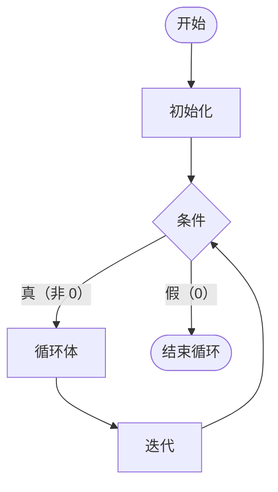

### 简单的 for 循环

语法：for 循环的语法和执行顺序

```c
for (初始化; 条件; 迭代) {
    语句;
}
```
- `初始化`（参数初始化） 在循环进入时执行一次，一般用于定义迭代变量，重置其他相关变量
- `条件`（条件判断） 和 while 一样，当条件为真时继续执行，当条件为假时就退出了 
- `迭代`（更新循环变量） 一般用于对迭代变量进行增减等操作，对循环主体的变量的操作原则上不应放到这里，应该放进循环体；如果迭代变量的迭代过于复杂， 也可以考虑放到循环体做处理

**流程图：**



形如

```c
int array[n];
for (int i = 0, temp; i < n; i++) {
    scanf("%d", &temp);
    array[i] = temp;
}
```

如无必要，请不要写形如下面代码的循环，尽可能将迭代变量的作用域控制在循环内，让他自行释放

```c
int i;
for (i = 0; i < n; i++) {

}
```
如果在外面定义了迭代变量，而且里面沿用了，那么在下面这个循环结束的时候，i 的值其实已经是 n 了，因为 i >= n 才会退出，所以 i 实际上已经迭代到 n 了

危险的地方在于，如果你忘记在某个循环对 i 做初始化（当然项目内可能是更复杂的结构体的初始化，很可能会忘记初始化某一部分细节），如果你每一次迭代都是在循环内定义迭代变量，那么会报错，你就能 debug

但如果你喜欢在外面定义迭代变量，很可能不会报错，而是沿用一个并没有重新初始化的迭代变量（譬如你在构建一个循环的时候被叫去干别的，或者去吃饭了，走之前来不及写 TODO 注释，回来忘记初始化，然后看到自己有个循环就去写下面的内容了）

---
