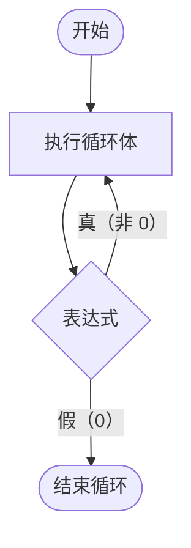

### 4.2.2 do-while

语法（注意：while 末尾必须有分号）
```c
do {
    循环体语句
} while (表达式);
```

**流程图：**


当型循环 while：先判断，再执行循环体
直到型 do while：不管咋样先执行一轮，再判断

### break

作用：立刻终止当前所在的**最内层循环**（或者 switch 语句），程序跳转到循环外的下一条语句。

**for 举例**：在 1 到 10 中找数字，一旦找到 5 就立刻停止寻找。

```c
for (int i = 1; i <= 10; i++) {
    if (i == 5) {
        break;  // 遇到 5，直接结束整个 for 循环
    }
    printf("%d ", i); // 只会打印 1 2 3 4
}
printf("循环结束\n");
```

### continue

作用：跳过当前循环体中 `continue` 后面的代码，**立刻进入下一次循环**（对于 `for` 循环，会先执行迭代 `i++`，再判断条件）。

**for 举例**：打印 1 到 5 的数字，但是跳过 3 不打印。

```c
for (int i = 1; i <= 5; i++) {
    if (i == 3) {
        continue; // 遇到 3，直接跳过，下面的 printf 不执行
    }
    printf("%d ", i); // 打印结果：1 2 4 5
}
```

---

### ⚠️ 诺注：continue 在 while 中的致命陷阱

在使用 `continue` 时要极其小心。在 `for` 循环中，`continue` 会执行 `i++`；但在 `while` 循环中，如果 `continue` 跳过了后面的迭代语句，可能会直接导致**死循环**。

**错误示例**：
```c
int i = 0;
while (i < 5) {
    if (i == 3) {
        continue; // 致命错误！i 永远等于 3，跳不到 i++ 那一步
    }
    printf("%d ", i);
    i++; // 被 continue 跳过了
}
```
**正确做法**：如果在 `while` 中使用 `continue`，一定要确保在 `continue` 执行前，循环变量已经发生了改变。
```c
int i = 0;
while (i < 5) {
    i++; // 把自增放在前面
    if (i == 3) {
        continue; 
    }
    printf("%d ", i - 1); 
}
```